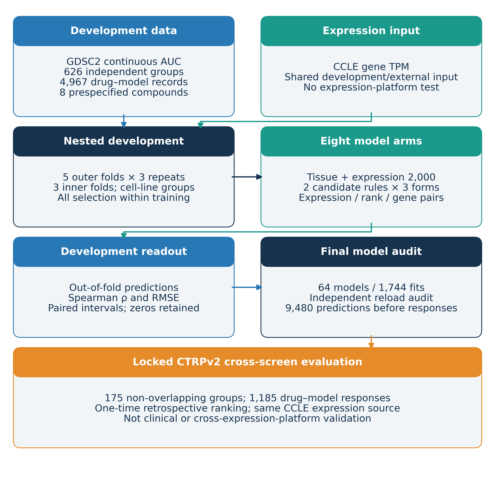

# REO drug-response evaluation

A leakage-controlled comparison of expression, within-sample ranks and relative-expression gene pairs for continuous cancer-cell-line drug-response prediction. The study separates tissue-reference performance, molecular increments and representation differences under matched candidate rules.

**Access — 27 October 2026:** this repository is public. Tracked code, configurations and aggregate results can be read anonymously. Two v0.1.0 packages containing the 64 frozen models and minimal identity/fold assets have been built and hash-checked; their [planned release/download entry](https://github.com/RascalZ/REO/releases/tag/v0.1.0) is **pending publication**. Zenodo has reserved software-archive DOI `10.5281/zenodo.23681422`; it is **not yet registered/published**. See [data and access conditions](docs/DATA_AVAILABILITY.md) and the [asset guide](reproducibility_v1/README.md).

## Study and results

- Development: CCLE expression and GDSC2 responses, 626 biological groups, eight fixed compounds, 5 outer folds × 3 repeats and 3 inner folds.
- Primary development pair-minus-strong-expression macro ΔSpearman: −0.00588, family-adjusted conditional interval [−0.01871, +0.00661].
- Locked external evaluation: 175 non-overlapping groups, 1,185 drug–group responses; primary macro ΔSpearman −0.000372 [−0.042166, +0.043505].
- No average pair advantage was established. These intervals establish neither equivalence nor non-inferiority. Both screens use the same CCLE expression source: this is retrospective cross-screen ranking transport, not cross-expression-platform or clinical validation.
- Zero molecular solutions and undefined correlations remain: 430/840 molecular outer fits were zero; the strict leave-one-tissue-out macro is NA (34/80 display contrasts defined).



The manuscript is unpublished. The current local reading copy is English v4 with a paired Chinese copy; author packages are Git-ignored. [Stage 31](reports/阶段31_Minor1与2最小补充.md) records the two latest clarifications. No paper DOI is claimed; the reserved software DOI is a separate identifier, pending actual archive publication. The sole maintained plan is [RESEARCH_PLAN.md](RESEARCH_PLAN.md).

## Quick start

Use Python 3.12 in an isolated environment. From the repository root:

```sh
python -m pip install -r requirements-repro-inference.txt
python scripts/predict_repro_v1.py --model examples/repro_inference_v1/toy_rank_model.json --input examples/repro_inference_v1/toy_input.json --output toy_predictions_new.json
```

The output path must be new. Parameters and inputs are handwritten; this is not a paper model or a drug-efficacy result. It reads no response labels and performs no fitting. See the [worked example](examples/repro_inference_v1/README.md).

## Reproduction checks

```sh
python scripts/verify_public_snapshot.py
python scripts/verify_public_ordinal.py
python scripts/verify_public_ordinal_repeated.py
python scripts/verify_repro_assets_v1.py
python -m unittest discover -s tests -p "test_repro_inference_v1.py" -v
```

The commands named `verify_public_*` inspect the tracked public aggregates. They verify recorded contracts and toy inference, not scientific retraining. [REPRODUCING.md](REPRODUCING.md) explains dependency layers, training protocols, model-access status and the completed external-evaluation boundary. CI checks aggregates and inference without opening sealed CTRP responses.

## Data and model access

| Material | Current location and access |
|---|---|
| Code, configurations, aggregate tables and figures | Publicly tracked here |
| Upstream CCLE, GDSC2, CTRP v2 and annotations | Versioned sources and applicable terms in [data availability](docs/DATA_AVAILABILITY.md) |
| Actual fitted models, preprocessing and coefficients | 64 byte-preserved models and parameter tables packaged; v0.1.0 download pending publication |
| Minimal derived identities, memberships and four frozen fold files | Packaged with audited projections; v0.1.0 download pending publication; full source pointers are excluded |
| Raw matrices, individual responses/predictions and checkpoints | Not distributed in this repository |
| Manuscript and submission materials | Local author package; no public release or all-author submission approval claimed |

## Project map

| Path | Purpose |
|---|---|
| `src/`, `scripts/`, `tests/` | Curation, modeling, inference, analysis and checks |
| `config/` | Frozen development and external contracts |
| `data_manifest/` | Source versions and provenance |
| `results/` | Aggregate outputs supporting the paper |
| `figures/manuscript_m08_v1/` | Four current figures and editable sources |
| `reproducibility_v1/` | Numeric model contract and toy inference |
| `docs/`, `reports/` | Protocols, evidence, audits and history |

Start with the [development protocol](docs/ORDINAL_REPEATED_V1_PROTOCOL.md), [external protocol](docs/EXTERNAL_VALIDATION_PROTOCOL_V1_1.md), [statistical assessment](docs/ORDINAL_REPEATED_ASSESSMENT.md) and [repository audit](docs/repository_release_v1/REPOSITORY_AUDIT.md). Detailed history remains in stage reports and the [preserved preceding README](docs/repository_release_v1/README_before_cleanup_20261026.md).

## Citation, contribution and license

Use [CITATION.cff](CITATION.cff), identifying the exact commit used while the first release is pending. The eight release creators follow the author-confirmed v4 order. A DOI reservation is not a published archive; final release/archival metadata will be recorded after publication and download verification.

[CONTRIBUTING.md](CONTRIBUTING.md) describes contribution boundaries. Newly authored reconstruction code and repository documentation use [MIT](LICENSE). Original model and derived assets have a separate [CC BY 4.0 grant](docs/public_release_v1/MODEL_ASSETS_LICENSE.md), limited to rights the authors own; third-party data, identifiers and annotations are not relicensed. Obtain upstream inputs independently under their terms. A public checkout and the minimal asset packages do not by themselves reconstruct every historical curation or evaluation step.
