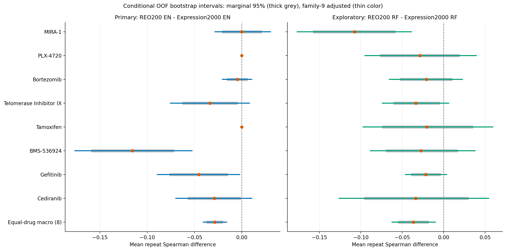
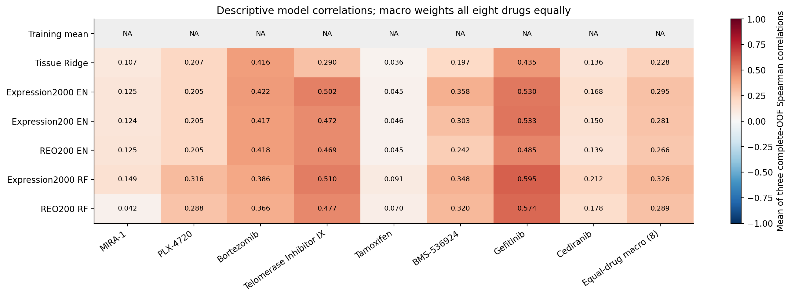
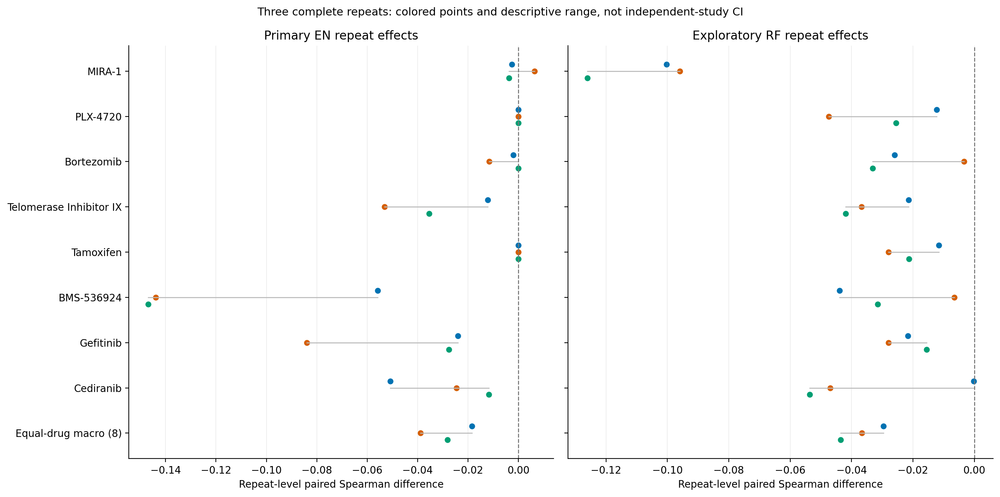
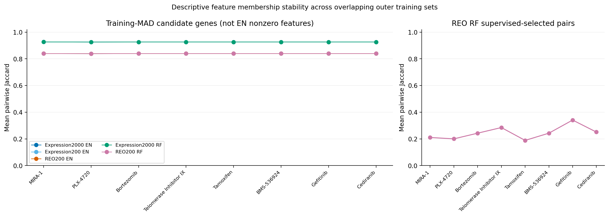

# 阶段4：固定八药重复嵌套开发评价

报告生成UTC：2026-10-12T14:15:51.088873+00:00；正式执行提交：db31a3508722adc996e2f5da3a9f924fb70444aa；报告生成提交：d997ac5188e12dc47b28d8f9d8d786eb4760e3cc。完整正式run和独立validator均通过后生成；此脚本仅读聚合统计、任务审计和metadata，未读取个体OOF、原响应、CTRP或表达矩阵。

## 完整性与当前证据

固定8药宏平均配对ΔSpearman：主EN -0.028458，家族9条件区间[-0.040677, -0.015947]；辅助RF -0.036612，家族9条件区间[-0.062252, -0.010272]。本次固定流程的方向不支持REO优于强表达；结论限当前面板与算法，区间不是完整训练算法泛化保证。研究价值、创新与下一诊断建议详见docs/FORMAL_SCIENTIFIC_ASSESSMENT.md及唯一总计划v2.5。

固定8药、7模型、外层5折×3次、内层3折已完成840/840个外层任务。主REO EN相对表达2000 EN的逐药平均ΔSpearman点方向：正1项、负5项、恰为0有2项、无定义0项；这些方向计数本身不是确证性检验。主REO EN有85/120个外层重拟合为零分子系数解，须结合组织贡献解释，不能将其全局相关归为分子REO信息。

全局独立生物组N为626；每个repeat为完整的一次OOF，不把3个repeat叠成三倍N。bootstrap为10000次同一global BIOGROUP抽样，跨药物、模型和repeat共用权重。CTRP响应访问False，访问防护尝试数0；独立药敏来源迁移和临床作用仍未验证。

## 主要配对结果：REO200 EN与表达2000 EN

| 固定任务 | 平均配对差 | 条件95%下限 | 条件95%上限 | 家族9条件下限 | 家族9条件上限 | 有效draws | 无定义draws | 区间状态 | NA原因 |
| --- | --- | --- | --- | --- | --- | --- | --- | --- | --- |
| MIRA-1 | 7.8173e-05 | -0.020984 | 0.021211 | -0.02836 | 0.030377 | 10000 | 0 | reported | NA |
| PLX-4720 | 0 | 0 | 0 | 0 | 0 | 10000 | 0 | reported | NA |
| Bortezomib | -0.0045367 | -0.015539 | 0.0062041 | -0.020465 | 0.010612 | 10000 | 0 | reported | NA |
| Telomerase Inhibitor IX | -0.03354 | -0.062901 | -0.0042872 | -0.075348 | 0.0080519 | 10000 | 0 | reported | NA |
| Tamoxifen | 0 | 0 | 0 | 0 | 0 | 10000 | 0 | reported | NA |
| BMS-536924 | -0.11553 | -0.15929 | -0.071485 | -0.17638 | -0.052641 | 10000 | 0 | reported | NA |
| Gefitinib | -0.045164 | -0.07648 | -0.01464 | -0.089188 | -0.0021774 | 10000 | 0 | reported | NA |
| Cediranib | -0.028976 | -0.057227 | -0.00088818 | -0.069637 | 0.010643 | 10000 | 0 | reported | NA |
| 固定8药等权宏平均 | -0.028458 | -0.037268 | -0.019784 | -0.040677 | -0.015947 | 10000 | 0 | reported | NA |

ΔSpearman为每药三个完整OOF相关差的算术均值；宏摘要固定等权8药。家族9包括8药与宏摘要，以Bonferroni双尾端点0.05/(2×9)提供名义家族校正条件区间，同时展示边际95%条件区间。NA任务、无定义draw及区间不足状态保留，不删除药物重算有利宏平均。

## 辅助架构结果：RF

| 固定任务 | 平均配对差 | 条件95%下限 | 条件95%上限 | 家族9条件下限 | 家族9条件上限 | 有效draws | 无定义draws | 区间状态 | NA原因 |
| --- | --- | --- | --- | --- | --- | --- | --- | --- | --- |
| MIRA-1 | -0.10746 | -0.15782 | -0.058365 | -0.17676 | -0.039044 | 10000 | 0 | reported | NA |
| PLX-4720 | -0.028384 | -0.076801 | 0.019336 | -0.095068 | 0.039534 | 10000 | 0 | reported | NA |
| Bortezomib | -0.020814 | -0.052938 | 0.010485 | -0.065657 | 0.022704 | 10000 | 0 | reported | NA |
| Telomerase Inhibitor IX | -0.033375 | -0.060755 | -0.0047442 | -0.074 | 0.0061041 | 10000 | 0 | reported | NA |
| Tamoxifen | -0.020283 | -0.074167 | 0.03557 | -0.097138 | 0.059223 | 10000 | 0 | reported | NA |
| BMS-536924 | -0.027299 | -0.069934 | 0.017199 | -0.088364 | 0.038028 | 10000 | 0 | reported | NA |
| Gefitinib | -0.021683 | -0.039383 | -0.003618 | -0.046157 | 0.0037462 | 10000 | 0 | reported | NA |
| Cediranib | -0.0336 | -0.096081 | 0.029956 | -0.1261 | 0.054454 | 10000 | 0 | reported | NA |
| 固定8药等权宏平均 | -0.036612 | -0.054921 | -0.018009 | -0.062252 | -0.010272 | 10000 | 0 | reported | NA |

RF结果属于独立secondary family9的探索性证据，不能在主EN弱时升为主结论；两个家族没有合并的全研究覆盖保证。REO RF包含训练内控制组织后关联筛至最多500对，表达RF没有对应pair监督筛选；差异是两条pipeline的比较，不能纯归因于排序编码。EN与RF对组织的处理也不同，跨家族比较不能证明某单一因素的作用。

## 误差指标、组织增量及模型分解

| 固定任务 | 平均配对差 | 条件95%下限 | 条件95%上限 | 家族9条件下限 | 家族9条件上限 | 有效draws | 无定义draws | 区间状态 | NA原因 |
| --- | --- | --- | --- | --- | --- | --- | --- | --- | --- |
| MIRA-1 | 6.3658e-05 | -0.0002021 | 0.0003481 | NA | NA | 10000 | 0 | reported | NA |
| PLX-4720 | 0 | 0 | 0 | NA | NA | 10000 | 0 | reported | NA |
| Bortezomib | 6.894e-05 | -0.00036985 | 0.00050593 | NA | NA | 10000 | 0 | reported | NA |
| Telomerase Inhibitor IX | -0.0020175 | -0.0039028 | -0.00014084 | NA | NA | 10000 | 0 | reported | NA |
| Tamoxifen | 0 | 0 | 0 | NA | NA | 10000 | 0 | reported | NA |
| BMS-536924 | -0.0041785 | -0.0064595 | -0.0019031 | NA | NA | 10000 | 0 | reported | NA |
| Gefitinib | -0.0010282 | -0.0018684 | -0.00029185 | NA | NA | 10000 | 0 | reported | NA |
| Cediranib | -4.511e-05 | -0.00086407 | 0.00072621 | NA | NA | 10000 | 0 | reported | NA |
| 固定8药等权宏平均 | -0.0008921 | -0.0012726 | -0.0005184 | NA | NA | 10000 | 0 | reported | NA |

RMSE配对差为参考表达减候选REO，正值表示名义误差改善；相关差则是REO减表达，正值表示名义排序改善。误差、MAE、R²及相对RMSE比例的详细区间在paired_effect_intervals.csv，属于描述性条件区间，不和主Spearman家族混为同一确证检验。回归损失用于内层选参，Spearman用于药物内排序评价，两者不保证同方向。

| gdsc_drug_id | comparison | point | conditional_95_lower | conditional_95_upper | ci_status |
| --- | --- | --- | --- | --- | --- |
| MIRA-1 | matched_gene_EN_ablation | 0.0011409 | -0.012039 | 0.014413 | reported |
| PLX-4720 | matched_gene_EN_ablation | 0 | 0 | 0 | reported |
| Bortezomib | matched_gene_EN_ablation | 0.00081826 | -0.0081926 | 0.010077 | reported |
| Telomerase Inhibitor IX | matched_gene_EN_ablation | -0.0036571 | -0.027163 | 0.019211 | reported |
| Tamoxifen | matched_gene_EN_ablation | -0.00095538 | -0.021537 | 0.020346 | reported |
| BMS-536924 | matched_gene_EN_ablation | -0.060232 | -0.089412 | -0.029686 | reported |
| Gefitinib | matched_gene_EN_ablation | -0.047613 | -0.074149 | -0.021638 | reported |
| Cediranib | matched_gene_EN_ablation | -0.011165 | -0.033203 | 0.010968 | reported |
| 固定8药等权宏平均 | matched_gene_EN_ablation | -0.015208 | -0.022785 | -0.0075275 | reported |
| MIRA-1 | REO_EN_vs_tissue | 0.017904 | -0.0036651 | 0.040035 | reported |
| PLX-4720 | REO_EN_vs_tissue | -0.0015884 | -0.012247 | 0.009726 | reported |
| Bortezomib | REO_EN_vs_tissue | 0.001778 | -0.0089229 | 0.012411 | reported |
| Telomerase Inhibitor IX | REO_EN_vs_tissue | 0.17926 | 0.12726 | 0.23216 | reported |
| Tamoxifen | REO_EN_vs_tissue | 0.0088808 | -0.018835 | 0.036966 | reported |
| BMS-536924 | REO_EN_vs_tissue | 0.045408 | 0.018467 | 0.07261 | reported |
| Gefitinib | REO_EN_vs_tissue | 0.050208 | 0.0034891 | 0.099698 | reported |
| Cediranib | REO_EN_vs_tissue | 0.002703 | -0.014157 | 0.02016 | reported |
| 固定8药等权宏平均 | REO_EN_vs_tissue | 0.03807 | 0.02579 | 0.050411 | reported |
| MIRA-1 | expression_EN_vs_tissue | 0.017826 | -0.0089025 | 0.044776 | reported |
| PLX-4720 | expression_EN_vs_tissue | -0.0015884 | -0.012247 | 0.009726 | reported |
| Bortezomib | expression_EN_vs_tissue | 0.0063147 | -0.0079702 | 0.021157 | reported |
| Telomerase Inhibitor IX | expression_EN_vs_tissue | 0.2128 | 0.15839 | 0.26809 | reported |
| Tamoxifen | expression_EN_vs_tissue | 0.0088808 | -0.018835 | 0.036966 | reported |
| BMS-536924 | expression_EN_vs_tissue | 0.16093 | 0.10549 | 0.21493 | reported |
| Gefitinib | expression_EN_vs_tissue | 0.095373 | 0.049547 | 0.14378 | reported |
| Cediranib | expression_EN_vs_tissue | 0.031679 | -0.0019596 | 0.06687 | reported |
| 固定8药等权宏平均 | expression_EN_vs_tissue | 0.066528 | 0.051673 | 0.081555 | reported |

| drug_id | model | outer_fits | zero_molecular_coefficient_outer_fits | outer_warning_fits | outer_fallback_fits | nonzero_coefficients_min | nonzero_coefficients_max | used_features_min | used_features_max |
| --- | --- | --- | --- | --- | --- | --- | --- | --- | --- |
| MIRA-1 | 表达2000 EN | 15 | 11 | 0 | 0 | 0 | 76 | 2000 | 2000 |
| MIRA-1 | 表达200 EN | 15 | 13 | 0 | 0 | 0 | 41 | 200 | 200 |
| MIRA-1 | REO200 EN | 15 | 14 | 0 | 0 | 0 | 149 | 19898 | 19900 |
| MIRA-1 | 表达2000 RF | 15 | 0 | 0 | 0 | NA | NA | 2000 | 2000 |
| MIRA-1 | REO200 RF | 15 | 0 | 0 | 0 | NA | NA | 500 | 500 |
| PLX-4720 | 表达2000 EN | 15 | 15 | 0 | 0 | 0 | 0 | 2000 | 2000 |
| PLX-4720 | 表达200 EN | 15 | 15 | 0 | 0 | 0 | 0 | 200 | 200 |
| PLX-4720 | REO200 EN | 15 | 15 | 0 | 0 | 0 | 0 | 19898 | 19900 |
| PLX-4720 | 表达2000 RF | 15 | 0 | 0 | 0 | NA | NA | 2000 | 2000 |
| PLX-4720 | REO200 RF | 15 | 0 | 0 | 0 | NA | NA | 500 | 500 |
| Bortezomib | 表达2000 EN | 15 | 12 | 0 | 0 | 0 | 91 | 2000 | 2000 |
| Bortezomib | 表达200 EN | 15 | 13 | 0 | 0 | 0 | 49 | 200 | 200 |
| Bortezomib | REO200 EN | 15 | 15 | 0 | 0 | 0 | 0 | 19898 | 19900 |
| Bortezomib | 表达2000 RF | 15 | 0 | 0 | 0 | NA | NA | 2000 | 2000 |
| Bortezomib | REO200 RF | 15 | 0 | 0 | 0 | NA | NA | 500 | 500 |
| Telomerase Inhibitor IX | 表达2000 EN | 15 | 0 | 0 | 0 | 46 | 65 | 2000 | 2000 |
| Telomerase Inhibitor IX | 表达200 EN | 15 | 0 | 0 | 0 | 11 | 76 | 200 | 200 |
| Telomerase Inhibitor IX | REO200 EN | 15 | 0 | 0 | 0 | 66 | 154 | 19898 | 19900 |
| Telomerase Inhibitor IX | 表达2000 RF | 15 | 0 | 0 | 0 | NA | NA | 2000 | 2000 |
| Telomerase Inhibitor IX | REO200 RF | 15 | 0 | 0 | 0 | NA | NA | 500 | 500 |
| Tamoxifen | 表达2000 EN | 15 | 15 | 0 | 0 | 0 | 0 | 2000 | 2000 |
| Tamoxifen | 表达200 EN | 15 | 11 | 0 | 0 | 0 | 48 | 200 | 200 |
| Tamoxifen | REO200 EN | 15 | 15 | 0 | 0 | 0 | 0 | 19898 | 19900 |
| Tamoxifen | 表达2000 RF | 15 | 0 | 0 | 0 | NA | NA | 2000 | 2000 |
| Tamoxifen | REO200 RF | 15 | 0 | 0 | 0 | NA | NA | 500 | 500 |
| BMS-536924 | 表达2000 EN | 15 | 0 | 0 | 0 | 36 | 64 | 2000 | 2000 |
| BMS-536924 | 表达200 EN | 15 | 2 | 0 | 0 | 0 | 33 | 200 | 200 |
| BMS-536924 | REO200 EN | 15 | 10 | 0 | 0 | 0 | 148 | 19898 | 19900 |
| BMS-536924 | 表达2000 RF | 15 | 0 | 0 | 0 | NA | NA | 2000 | 2000 |
| BMS-536924 | REO200 RF | 15 | 0 | 0 | 0 | NA | NA | 500 | 500 |
| Gefitinib | 表达2000 EN | 15 | 0 | 0 | 0 | 36 | 57 | 2000 | 2000 |
| Gefitinib | 表达200 EN | 15 | 0 | 0 | 0 | 20 | 36 | 200 | 200 |
| Gefitinib | REO200 EN | 15 | 1 | 0 | 0 | 0 | 140 | 19898 | 19900 |
| Gefitinib | 表达2000 RF | 15 | 0 | 0 | 0 | NA | NA | 2000 | 2000 |
| Gefitinib | REO200 RF | 15 | 0 | 0 | 0 | NA | NA | 500 | 500 |
| Cediranib | 表达2000 EN | 15 | 11 | 0 | 0 | 0 | 132 | 2000 | 2000 |
| Cediranib | 表达200 EN | 15 | 10 | 0 | 0 | 0 | 21 | 200 | 200 |
| Cediranib | REO200 EN | 15 | 15 | 0 | 0 | 0 | 0 | 19898 | 19900 |
| Cediranib | 表达2000 RF | 15 | 0 | 0 | 0 | NA | NA | 2000 | 2000 |
| Cediranib | REO200 RF | 15 | 0 | 0 | 0 | NA | NA | 500 | 500 |

零分子系数EN仍可由组织均值产生全局相关及误差改善；这不是基因对标志物或组织内个体信号。没有零系数也不自动证明独立增量。上表警告与fallback仅统计外层重拟合；不将0外层warning误读为全部内层候选fit均无warning。任何有限预测的求解警告、空特征回退和真实失败都需按完整validator及运行记录继续审阅。

## 重复稳定性与特征成员稳定性

| gdsc_drug_id | comparison | repeat_values | repeat_mean | repeat_min | repeat_max | repeat_range | repeat_sample_sd |
| --- | --- | --- | --- | --- | --- | --- | --- |
| MIRA-1 | primary_EN | [-0.0024871397175177667, 0.006414606847880477, -0.003692947794340984] | 7.8173e-05 | -0.0036929 | 0.0064146 | 0.010108 | 0.0055205 |
| PLX-4720 | primary_EN | [0.0, 0.0, 0.0] | 0 | 0 | 0 | 0 | 0 |
| Bortezomib | primary_EN | [-0.0020298680746876907, -0.011580300082610406, 0.0] | -0.0045367 | -0.01158 | 0 | 0.01158 | 0.0061838 |
| Telomerase Inhibitor IX | primary_EN | [-0.012153098131063633, -0.05309941375304106, -0.0353671831834913] | -0.03354 | -0.053099 | -0.012153 | 0.040946 | 0.020534 |
| Tamoxifen | primary_EN | [0.0, 0.0, 0.0] | 0 | 0 | 0 | 0 | 0 |
| BMS-536924 | primary_EN | [-0.055821708168213635, -0.14383620738210645, -0.1469207083386283] | -0.11553 | -0.14692 | -0.055822 | 0.091099 | 0.051729 |
| Gefitinib | primary_EN | [-0.02397415810004666, -0.0839487819075786, -0.02756989285426925] | -0.045164 | -0.083949 | -0.023974 | 0.059975 | 0.033636 |
| Cediranib | primary_EN | [-0.05074796450274138, -0.024496818398532197, -0.01168194779779222] | -0.028976 | -0.050748 | -0.011682 | 0.039066 | 0.019914 |
| 固定8药等权宏平均 | primary_EN | [-0.018401742086783846, -0.03881836433449853, -0.028154084996065257] | -0.028458 | -0.038818 | -0.018402 | 0.020417 | 0.010212 |
| MIRA-1 | secondary_RF | [-0.10030819122449214, -0.09599106139034641, -0.12607472052652188] | -0.10746 | -0.12607 | -0.095991 | 0.030084 | 0.016266 |
| PLX-4720 | secondary_RF | [-0.01222294304634236, -0.04741706227843101, -0.025512237042874752] | -0.028384 | -0.047417 | -0.012223 | 0.035194 | 0.017772 |
| Bortezomib | secondary_RF | [-0.02591183606348546, -0.0034009520853205966, -0.03312873241840697] | -0.020814 | -0.033129 | -0.003401 | 0.029728 | 0.015506 |
| Telomerase Inhibitor IX | secondary_RF | [-0.02137861820213799, -0.03678541722883988, -0.04196005564228572] | -0.033375 | -0.04196 | -0.021379 | 0.020581 | 0.010706 |
| Tamoxifen | secondary_RF | [-0.011593599271402202, -0.027960666271445625, -0.021295766586068313] | -0.020283 | -0.027961 | -0.011594 | 0.016367 | 0.0082304 |
| BMS-536924 | secondary_RF | [-0.043908183756199815, -0.00650025212588784, -0.03148769681179425] | -0.027299 | -0.043908 | -0.0065003 | 0.037408 | 0.019053 |
| Gefitinib | secondary_RF | [-0.021575188964449987, -0.027936674062544076, -0.015536503554220427] | -0.021683 | -0.027937 | -0.015537 | 0.0124 | 0.0062008 |
| Cediranib | secondary_RF | [-0.00020130293044801073, -0.04694164808088774, -0.05365634447875858] | -0.0336 | -0.053656 | -0.0002013 | 0.053455 | 0.029118 |
| 固定8药等权宏平均 | secondary_RF | [-0.029637482932369744, -0.036616716690462896, -0.04358150713261637] | -0.036612 | -0.043582 | -0.029637 | 0.013944 | 0.006972 |

feature_stability.csv报告不同外层训练集合的pairwise Jaccard及比较数。EN审计仅保存候选gene/pair名单和非零数，未保存非零系数对应的feature列表，故本报告不伪造EN active-feature Jaccard。REO RF的pair成员稳定性包含监督筛选步骤。高成员稳定性不能替代预测增量、独立验证或机制证据。

## 运行资源、选参与来源绑定

| 会话 | 状态 | 墙钟秒 | 进程树采样峰值RSS GiB | 会话完成任务 | 最大inflight |
| --- | --- | --- | --- | --- | --- |
| 1 | failed | 18243 | 1.3517 | 673 | 2 |
| 2 | completed | 3974.5 | 1.0627 | 167 | 1 |

| drug_id | model | outer_tasks | task_wall_seconds_sum | task_cpu_seconds_sum | worker_task_peak_rss_GiB_max | worker_lifetime_peak_working_set_GiB_max |
| --- | --- | --- | --- | --- | --- | --- |
| MIRA-1 | 训练均值 | 15 | 3.0688 | 1.4062 | 0.53835 | 0.91013 |
| MIRA-1 | 组织Ridge | 15 | 7.2946 | 7.1094 | 0.63542 | 0.91168 |
| MIRA-1 | 表达2000 EN | 15 | 209.24 | 202.95 | 0.68181 | 0.91013 |
| MIRA-1 | 表达200 EN | 15 | 165.81 | 161.69 | 0.67762 | 0.91168 |
| MIRA-1 | REO200 EN | 15 | 640.13 | 622.42 | 0.86013 | 0.91168 |
| MIRA-1 | 表达2000 RF | 15 | 1892 | 1839.8 | 0.68812 | 0.91168 |
| MIRA-1 | REO200 RF | 15 | 306.15 | 296.61 | 0.69235 | 0.91168 |
| PLX-4720 | 训练均值 | 15 | 1.0179 | 1 | 0.52002 | 0.91168 |
| PLX-4720 | 组织Ridge | 15 | 6.7775 | 6.6406 | 0.64844 | 0.91168 |
| PLX-4720 | 表达2000 EN | 15 | 193.31 | 189.52 | 0.67221 | 0.91168 |
| PLX-4720 | 表达200 EN | 15 | 156.8 | 153.14 | 0.6759 | 0.91168 |
| PLX-4720 | REO200 EN | 15 | 599.84 | 588.19 | 0.85886 | 0.91168 |
| PLX-4720 | 表达2000 RF | 15 | 1654.9 | 1624.4 | 0.68883 | 0.91168 |
| PLX-4720 | REO200 RF | 15 | 270.71 | 265.55 | 0.69397 | 0.91168 |
| Bortezomib | 训练均值 | 15 | 0.99114 | 0.98438 | 0.47311 | 0.91168 |
| Bortezomib | 组织Ridge | 15 | 6.8574 | 6.7188 | 0.59121 | 0.91168 |
| Bortezomib | 表达2000 EN | 15 | 193.34 | 188.41 | 0.64985 | 0.91168 |
| Bortezomib | 表达200 EN | 15 | 150.68 | 147.92 | 0.63032 | 0.91168 |
| Bortezomib | REO200 EN | 15 | 547.28 | 539.27 | 0.84435 | 0.91168 |
| Bortezomib | 表达2000 RF | 15 | 1126.1 | 1107 | 0.64508 | 0.91168 |
| Bortezomib | REO200 RF | 15 | 277.36 | 270.58 | 0.64201 | 0.91168 |
| Telomerase Inhibitor IX | 训练均值 | 15 | 2.9556 | 1.4531 | 0.5494 | 0.91168 |
| Telomerase Inhibitor IX | 组织Ridge | 15 | 7.6281 | 7.5 | 0.52987 | 0.91168 |
| Telomerase Inhibitor IX | 表达2000 EN | 15 | 222.3 | 214.92 | 0.62713 | 0.91168 |
| Telomerase Inhibitor IX | 表达200 EN | 15 | 182.71 | 175.37 | 0.57042 | 0.91168 |
| Telomerase Inhibitor IX | REO200 EN | 15 | 627.41 | 606.42 | 0.84539 | 0.91168 |
| Telomerase Inhibitor IX | 表达2000 RF | 15 | 1262.3 | 1224.1 | 0.57986 | 0.91168 |
| Telomerase Inhibitor IX | REO200 RF | 15 | 324.23 | 313.95 | 0.57815 | 0.91168 |
| Tamoxifen | 训练均值 | 15 | 3.8389 | 1.6562 | 0.50635 | 0.91168 |
| Tamoxifen | 组织Ridge | 15 | 9.0927 | 8.6719 | 0.52705 | 0.91168 |
| Tamoxifen | 表达2000 EN | 15 | 249.35 | 240.2 | 0.56814 | 0.91168 |
| Tamoxifen | 表达200 EN | 15 | 201.26 | 191.05 | 0.55912 | 0.91168 |
| Tamoxifen | REO200 EN | 15 | 727.66 | 702.37 | 0.77562 | 0.91168 |
| Tamoxifen | 表达2000 RF | 15 | 1502.9 | 1446.4 | 0.56762 | 0.91168 |
| Tamoxifen | REO200 RF | 15 | 359.75 | 344.77 | 0.57671 | 0.91168 |
| BMS-536924 | 训练均值 | 15 | 3.8072 | 1.5781 | 0.40893 | 0.91168 |
| BMS-536924 | 组织Ridge | 15 | 8.1796 | 7.8281 | 0.52845 | 0.91168 |
| BMS-536924 | 表达2000 EN | 15 | 241.75 | 231.5 | 0.56972 | 0.91168 |
| BMS-536924 | 表达200 EN | 15 | 197.97 | 186.11 | 0.55954 | 0.91168 |
| BMS-536924 | REO200 EN | 15 | 730.06 | 703.8 | 0.79618 | 0.91168 |
| BMS-536924 | 表达2000 RF | 15 | 1588.5 | 1531 | 0.56801 | 0.91168 |
| BMS-536924 | REO200 RF | 15 | 341.63 | 328.28 | 0.57375 | 0.91168 |
| Gefitinib | 训练均值 | 15 | 3.664 | 1.3125 | 0.51811 | 0.98207 |
| Gefitinib | 组织Ridge | 15 | 6.8296 | 6.7031 | 0.63927 | 0.98207 |
| Gefitinib | 表达2000 EN | 15 | 184.58 | 181.7 | 0.69281 | 0.98207 |
| Gefitinib | 表达200 EN | 15 | 148.37 | 146.83 | 0.67338 | 0.98207 |
| Gefitinib | REO200 EN | 15 | 547.89 | 540.31 | 0.97744 | 0.98621 |
| Gefitinib | 表达2000 RF | 15 | 1290.9 | 1271.9 | 0.68478 | 0.98621 |
| Gefitinib | REO200 RF | 15 | 254.66 | 251.02 | 0.68925 | 0.98621 |
| Cediranib | 训练均值 | 15 | 0.9574 | 0.95312 | 0.51883 | 0.98621 |
| Cediranib | 组织Ridge | 15 | 6.5064 | 6.4375 | 0.6403 | 0.98621 |
| Cediranib | 表达2000 EN | 15 | 185.94 | 183.39 | 0.69995 | 0.98621 |
| Cediranib | 表达200 EN | 15 | 149.18 | 147.45 | 0.67466 | 0.98621 |
| Cediranib | REO200 EN | 15 | 542.58 | 535.75 | 0.90148 | 0.98621 |
| Cediranib | 表达2000 RF | 15 | 1353.2 | 1334 | 0.69351 | 0.98621 |
| Cediranib | REO200 RF | 15 | 259.7 | 255.69 | 0.69173 | 0.98621 |

两会话计算墙钟合计22217.7秒（6.17小时），不含中断空档、首轮输入准备及后处理。保留1次控制器失败会话；模型failed为0，全拟合solver warnings为0，记录的回退为0。673任务后Windows元数据替换WinError5已保存，非冻结监控改用追加日志、串行后处理，原数值源码未改。原673检查点逐个SHA保持的独立恢复证据见results/formal_development/recovery_and_execution_summary.json。

会话墙钟及进程树RSS采样从任务调度阶段开始，未覆盖此前输入准备，亦不包含后处理。逐模型task时间含内层搜索、外层重拟合、输入缓存及预测，sum不可当并行时的总墙钟。worker RSS含库、映射页面和当前/历史缓存；Windows lifetime peak可早于当前任务，不能把它当某模型独占或新增内存。不同进程RSS求和还可能重复计入共享页面。

chosen_parameter_summary.csv保留每个外层任务的参数、alpha/alpha_max、相对路径、理论null状态、dual gap与边界。ratio=1可以是合理null选择；最弱端点常被选则提示搜索边界。预设网格及有限迭代算法保持，不能据本结果或外验事后换网格追求REO获胜。不同候选次数及维数不能直接解释为同等调参充分度。

正式统计协议SHA256：4e4393810b6637434f32bac0eb48e285fc4cb2ec87465abe2e8d0be01c2d939d；统计配置SHA256：1936f62a92a5510bcfc6f4ff979898996bb09eae5972ed28fcc7f5cb8caf65b8；formal lock SHA256：95dff1cc4cedda60cffd58c6a3c4119a3c8018dd7ad54910726f2a1a25c8c3dc；bootstrap count matrix SHA256：aabb36a1077b7347b5b3d9101956798b7a89a94f8ef3fa385e99d8f652ea9811。validator来源：runs/gdsc2-cancer-v2-fixed8-nested5x3-inner3-formal-v1/formal_validation.json，SHA256：c1c6e6d56390e78c28b1d762bdc3f33f3d3c6cbc3ab00ec4ed77d5d9077bbdda。

## 证据的实际边界与下一决定

- 全部区间条件于已生成OOF记录，没有重新特征选择、调参和训练，不覆盖完整算法不确定性或保证CV泛化性能覆盖；Bonferroni调整不能修复这一基础限制。
- 重复CV改善划分稳定性描述，不增加独立样本N；非显著或区间跨0不证明等效，当前没有事先建立的实际意义/等效界值。
- 不存在来自bootstrap正负尾部比例的确证P值；全部8药、宏摘要、失败及NA应一并判断，不挑最佳任务。
- 先审查主要效应幅度、重复方向、组织/零分子贡献和辅助架构一致性，再科学评估方法合理性、创新与发表价值。此报告不自动宣称普遍优势、临床成功或可投稿定稿。
- 冻结CTRP评价、全开发最终模型锁及必要的后续研究方向判断仍是独立gate；不能因开发结果弱而恢复旧泄漏流程，或临时添加机制/深度模型包装优势。

聚合统计与新增描述表均在results/formal_development；图形SVG/PNG在reports/figures_formal。公开输出不包含个体响应、fit成员ID或bootstrap组名单。
