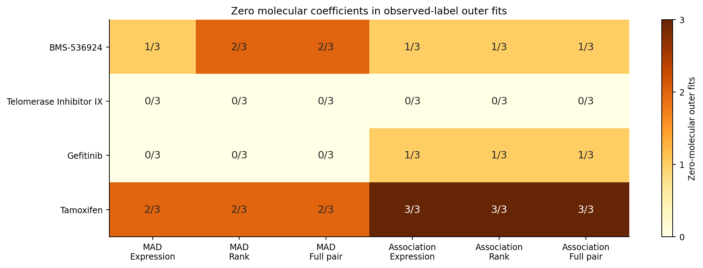
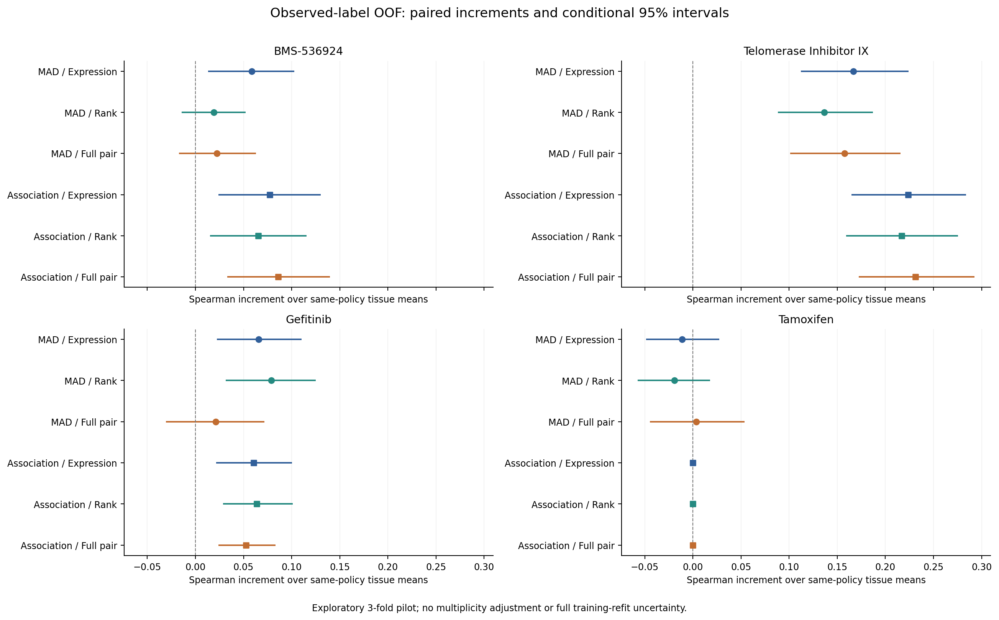
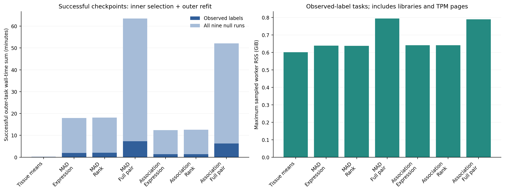

# 阶段5：候选规则、秩向量与完整基因对的诊断试跑

两种候选规则×三种表示，同政策组织均值参照，三种诊断药加Tamoxifen，以及九套全流程组织内置换标签。协议先于本轮拟合冻结，属于见过正式v1结果后的探索性研究。原正式v1结果保留，CTRP继续封存。

最终成功的840个外层任务包含22,440次完整拟合，保存173,600条OOF记录。该拟合数是最终纳入既定评价的预算，不含历史失败尝试中的已完成拟合及独立资源排障probe；额外开销在后文单列。真实独立观察为四药各620个模型，不是OOF行数。仅3折外层×1次、3折内层；没有重复CV稳定性证据。

当前判读：训练内响应关联候选改善了三种表示的四案例平均预测；但该规则下pair相对表达200的宏ΔSpearman为+0.002021 [-0.010449, +0.014278]，仍不能证明REO可靠优势或等价。值得继续固定八药评价，研究候选规则与表示约束的适用边界；不能以本轮案例替代旧正式v1结论。

新规则的活跃基因对仍不稳定，预测增量不能直接写成机制性耐药签名。完整科学解读见docs/ORDINAL_DIAGNOSTIC_ASSESSMENT.md，下一工作包和唯一维护计划见RESEARCH_PLAN.md。以下保留所有药物、表示、指标、零解与失败。

## 预设问题与解释边界

在同一个训练划分内，MAD或组织调整响应关联规则各选最多200个基因；该规则的表达、样本内平均秩及完整三值pair臂共享基因。完整pair与平均秩有相同排序信息，但线性rank只对应受约束的pair权重，EN惩罚不同。因此两者的性能差不是纯维度损失；表达与rank差也不是可识别的纯幅度信息损失。

同政策组织参照使用训练组织响应均值，训练未见组织用训练总体均值；这是分子系数为零时的同政策比较。Tamoxifen是历史弱信号案例，不能当作已知真阴性，出现增益本身不证明泄漏。三个主诊断案例由旧结果启发，四药均值不替代固定八药正式结论。

## 真实标签下的性能与分子使用

| 药物 | 模型 | Spearman | RMSE | MAE | R² | 零分子拟合 | 预测偏离组织参照RMS |
| --- | --- | --- | --- | --- | --- | --- | --- |
| BMS-536924 | Tissue means | 0.2237 | 0.10135 | 0.07694 | 0.0604 | 参照 | 0.000000 |
| BMS-536924 | MAD / Expression | 0.2821 | 0.10002 | 0.07567 | 0.0849 | 1/3 | 0.020950 |
| BMS-536924 | MAD / Rank | 0.2430 | 0.10075 | 0.07613 | 0.0714 | 2/3 | 0.014741 |
| BMS-536924 | MAD / Full pair | 0.2460 | 0.10069 | 0.07591 | 0.0725 | 2/3 | 0.019774 |
| BMS-536924 | Association / Expression | 0.3010 | 0.09863 | 0.07398 | 0.1101 | 1/3 | 0.028618 |
| BMS-536924 | Association / Rank | 0.2889 | 0.09985 | 0.07494 | 0.0880 | 1/3 | 0.025978 |
| BMS-536924 | Association / Full pair | 0.3098 | 0.09937 | 0.07472 | 0.0968 | 1/3 | 0.031188 |
| Telomerase Inhibitor IX | Tissue means | 0.2954 | 0.10424 | 0.08475 | 0.1226 | 参照 | 0.000000 |
| Telomerase Inhibitor IX | MAD / Expression | 0.4623 | 0.09871 | 0.07887 | 0.2133 | 0/3 | 0.037623 |
| Telomerase Inhibitor IX | MAD / Rank | 0.4321 | 0.09927 | 0.08028 | 0.2043 | 0/3 | 0.027125 |
| Telomerase Inhibitor IX | MAD / Full pair | 0.4530 | 0.09859 | 0.07871 | 0.2152 | 0/3 | 0.038680 |
| Telomerase Inhibitor IX | Association / Expression | 0.5193 | 0.09517 | 0.07633 | 0.2686 | 0/3 | 0.045542 |
| Telomerase Inhibitor IX | Association / Rank | 0.5126 | 0.09531 | 0.07629 | 0.2666 | 0/3 | 0.042166 |
| Telomerase Inhibitor IX | Association / Full pair | 0.5267 | 0.09452 | 0.07547 | 0.2787 | 0/3 | 0.041063 |
| Gefitinib | Tissue means | 0.4472 | 0.04314 | 0.02430 | 0.0922 | 参照 | 0.000000 |
| Gefitinib | MAD / Expression | 0.5130 | 0.04126 | 0.02315 | 0.1692 | 0/3 | 0.011152 |
| Gefitinib | MAD / Rank | 0.5259 | 0.04105 | 0.02334 | 0.1778 | 0/3 | 0.012257 |
| Gefitinib | MAD / Full pair | 0.4683 | 0.04203 | 0.02478 | 0.1382 | 0/3 | 0.015503 |
| Gefitinib | Association / Expression | 0.5079 | 0.04173 | 0.02319 | 0.1503 | 1/3 | 0.011718 |
| Gefitinib | Association / Rank | 0.5109 | 0.04219 | 0.02315 | 0.1317 | 1/3 | 0.010353 |
| Gefitinib | Association / Full pair | 0.4997 | 0.04210 | 0.02309 | 0.1353 | 1/3 | 0.010208 |
| Tamoxifen | Tissue means | 0.0750 | 0.03753 | 0.02970 | -0.0313 | 参照 | 0.000000 |
| Tamoxifen | MAD / Expression | 0.0640 | 0.03786 | 0.02983 | -0.0493 | 2/3 | 0.004956 |
| Tamoxifen | MAD / Rank | 0.0557 | 0.03794 | 0.02999 | -0.0538 | 2/3 | 0.004491 |
| Tamoxifen | MAD / Full pair | 0.0787 | 0.03828 | 0.03005 | -0.0729 | 2/3 | 0.007377 |
| Tamoxifen | Association / Expression | 0.0750 | 0.03753 | 0.02970 | -0.0313 | 3/3 | 0.000000 |
| Tamoxifen | Association / Rank | 0.0750 | 0.03753 | 0.02970 | -0.0313 | 3/3 | 0.000000 |
| Tamoxifen | Association / Full pair | 0.0750 | 0.03753 | 0.02970 | -0.0313 | 3/3 | 0.000000 |

非零系数不等于有效分子信号；同时看相对同政策组织参照的外层增量、区间与预测偏离程度。零解未筛除。空活跃集合的Jaccard记为NA，不用1制造虚假的稳定性；三个重叠训练折的特征一致性仅作描述。

图1：真实标签外层拟合的零分子解。

## 配对增量与条件置信区间

全部15种预设比较及四指标均保留。Spearman/R²正向为候选减参照，RMSE/MAE为参照减候选。用全部626个开发生物学组的同一套10,000次抽样重算配对指标；区间是未校正95%条件OOF区间，不涵盖训练、特征选择或调参重做的算法不确定性。不能据此作等效、因果比例或四药之外的普遍优势主张。

图2：六个分子臂相对同政策组织参照的配对Spearman增量。圆形MAD，方形响应关联。

| 药物 | 比较 | ΔSpearman [95%CI] | RMSE改善量 [95%CI] |
| --- | --- | --- | --- |
| BMS-536924 | mad:rank-expression | -0.0391 [-0.0756, -0.0028] | -0.00073 [-0.00206, +0.00060] |
| BMS-536924 | mad:pair_full-rank | +0.0030 [-0.0202, +0.0272] | +0.00006 [-0.00092, +0.00111] |
| BMS-536924 | mad:pair_full-expression | -0.0360 [-0.0776, +0.0054] | -0.00067 [-0.00244, +0.00109] |
| BMS-536924 | response_association:rank-expression | -0.0120 [-0.0305, +0.0067] | -0.00122 [-0.00238, -0.00012] |
| BMS-536924 | response_association:pair_full-rank | +0.0209 [-0.0035, +0.0459] | +0.00048 [-0.00116, +0.00222] |
| BMS-536924 | response_association:pair_full-expression | +0.0089 [-0.0200, +0.0372] | -0.00074 [-0.00256, +0.00107] |
| BMS-536924 | expression:association-MAD | +0.0189 [-0.0183, +0.0566] | +0.00139 [-0.00108, +0.00398] |
| BMS-536924 | rank:association-MAD | +0.0459 [+0.0014, +0.0909] | +0.00090 [-0.00133, +0.00314] |
| BMS-536924 | pair_full:association-MAD | +0.0638 [+0.0207, +0.1082] | +0.00132 [-0.00144, +0.00398] |
| BMS-536924 | mad_expression-tissue_null | +0.0584 [+0.0139, +0.1019] | +0.00133 [-0.00017, +0.00284] |
| BMS-536924 | mad_rank-tissue_null | +0.0193 [-0.0134, +0.0513] | +0.00060 [-0.00072, +0.00192] |
| BMS-536924 | mad_pair_full-tissue_null | +0.0223 [-0.0165, +0.0621] | +0.00066 [-0.00116, +0.00262] |
| BMS-536924 | response_association_expression-tissue_null | +0.0772 [+0.0245, +0.1294] | +0.00272 [-0.00007, +0.00562] |
| BMS-536924 | response_association_rank-tissue_null | +0.0652 [+0.0160, +0.1146] | +0.00150 [-0.00101, +0.00412] |
| BMS-536924 | response_association_pair_full-tissue_null | +0.0861 [+0.0339, +0.1391] | +0.00198 [-0.00099, +0.00493] |
| Telomerase Inhibitor IX | mad:rank-expression | -0.0303 [-0.0601, -0.0002] | -0.00056 [-0.00250, +0.00135] |
| Telomerase Inhibitor IX | mad:pair_full-rank | +0.0210 [-0.0114, +0.0533] | +0.00068 [-0.00134, +0.00268] |
| Telomerase Inhibitor IX | mad:pair_full-expression | -0.0093 [-0.0428, +0.0235] | +0.00012 [-0.00212, +0.00233] |
| Telomerase Inhibitor IX | response_association:rank-expression | -0.0067 [-0.0252, +0.0120] | -0.00013 [-0.00141, +0.00118] |
| Telomerase Inhibitor IX | response_association:pair_full-rank | +0.0141 [-0.0102, +0.0388] | +0.00079 [-0.00091, +0.00251] |
| Telomerase Inhibitor IX | response_association:pair_full-expression | +0.0074 [-0.0174, +0.0329] | +0.00066 [-0.00106, +0.00240] |
| Telomerase Inhibitor IX | expression:association-MAD | +0.0570 [+0.0197, +0.0931] | +0.00353 [+0.00076, +0.00619] |
| Telomerase Inhibitor IX | rank:association-MAD | +0.0805 [+0.0440, +0.1175] | +0.00397 [+0.00136, +0.00652] |
| Telomerase Inhibitor IX | pair_full:association-MAD | +0.0737 [+0.0324, +0.1158] | +0.00407 [+0.00117, +0.00698] |
| Telomerase Inhibitor IX | mad_expression-tissue_null | +0.1669 [+0.1129, +0.2235] | +0.00554 [+0.00277, +0.00837] |
| Telomerase Inhibitor IX | mad_rank-tissue_null | +0.1366 [+0.0893, +0.1862] | +0.00497 [+0.00282, +0.00712] |
| Telomerase Inhibitor IX | mad_pair_full-tissue_null | +0.1576 [+0.1020, +0.2152] | +0.00566 [+0.00268, +0.00863] |
| Telomerase Inhibitor IX | response_association_expression-tissue_null | +0.2239 [+0.1655, +0.2832] | +0.00907 [+0.00554, +0.01250] |
| Telomerase Inhibitor IX | response_association_rank-tissue_null | +0.2171 [+0.1601, +0.2748] | +0.00894 [+0.00563, +0.01218] |
| Telomerase Inhibitor IX | response_association_pair_full-tissue_null | +0.2313 [+0.1731, +0.2918] | +0.00973 [+0.00647, +0.01302] |
| Gefitinib | mad:rank-expression | +0.0129 [-0.0050, +0.0304] | +0.00021 [-0.00020, +0.00056] |
| Gefitinib | mad:pair_full-rank | -0.0576 [-0.0890, -0.0258] | -0.00098 [-0.00184, -0.00019] |
| Gefitinib | mad:pair_full-expression | -0.0447 [-0.0818, -0.0083] | -0.00076 [-0.00180, +0.00019] |
| Gefitinib | response_association:rank-expression | +0.0030 [-0.0174, +0.0239] | -0.00046 [-0.00106, +0.00011] |
| Gefitinib | response_association:pair_full-rank | -0.0112 [-0.0374, +0.0137] | +0.00009 [-0.00074, +0.00094] |
| Gefitinib | response_association:pair_full-expression | -0.0082 [-0.0386, +0.0218] | -0.00037 [-0.00125, +0.00052] |
| Gefitinib | expression:association-MAD | -0.0051 [-0.0422, +0.0326] | -0.00047 [-0.00158, +0.00081] |
| Gefitinib | rank:association-MAD | -0.0150 [-0.0521, +0.0234] | -0.00113 [-0.00225, +0.00008] |
| Gefitinib | pair_full:association-MAD | +0.0314 [-0.0152, +0.0791] | -0.00007 [-0.00173, +0.00177] |
| Gefitinib | mad_expression-tissue_null | +0.0658 [+0.0229, +0.1096] | +0.00187 [+0.00086, +0.00280] |
| Gefitinib | mad_rank-tissue_null | +0.0787 [+0.0324, +0.1243] | +0.00208 [+0.00096, +0.00310] |
| Gefitinib | mad_pair_full-tissue_null | +0.0211 [-0.0297, +0.0709] | +0.00111 [-0.00052, +0.00255] |
| Gefitinib | response_association_expression-tissue_null | +0.0607 [+0.0224, +0.0995] | +0.00140 [+0.00031, +0.00267] |
| Gefitinib | response_association_rank-tissue_null | +0.0637 [+0.0294, +0.1004] | +0.00095 [+0.00003, +0.00203] |
| Gefitinib | response_association_pair_full-tissue_null | +0.0525 [+0.0248, +0.0826] | +0.00104 [-0.00006, +0.00235] |
| Tamoxifen | mad:rank-expression | -0.0083 [-0.0273, +0.0107] | -0.00008 [-0.00028, +0.00013] |
| Tamoxifen | mad:pair_full-rank | +0.0230 [-0.0093, +0.0550] | -0.00034 [-0.00084, +0.00014] |
| Tamoxifen | mad:pair_full-expression | +0.0147 [-0.0205, +0.0500] | -0.00042 [-0.00097, +0.00011] |
| Tamoxifen | response_association:rank-expression | +0.0000 [+0.0000, +0.0000] | -0.00000 [-0.00000, +0.00000] |
| Tamoxifen | response_association:pair_full-rank | +0.0000 [+0.0000, +0.0000] | -0.00000 [-0.00000, +0.00000] |
| Tamoxifen | response_association:pair_full-expression | +0.0000 [+0.0000, +0.0000] | -0.00000 [-0.00000, +0.00000] |
| Tamoxifen | expression:association-MAD | +0.0110 [-0.0265, +0.0480] | +0.00033 [-0.00004, +0.00070] |
| Tamoxifen | rank:association-MAD | +0.0193 [-0.0169, +0.0566] | +0.00041 [+0.00005, +0.00078] |
| Tamoxifen | pair_full:association-MAD | -0.0037 [-0.0527, +0.0440] | +0.00075 [+0.00007, +0.00146] |
| Tamoxifen | mad_expression-tissue_null | -0.0110 [-0.0480, +0.0265] | -0.00033 [-0.00070, +0.00004] |
| Tamoxifen | mad_rank-tissue_null | -0.0193 [-0.0566, +0.0169] | -0.00041 [-0.00078, -0.00005] |
| Tamoxifen | mad_pair_full-tissue_null | +0.0037 [-0.0440, +0.0527] | -0.00075 [-0.00146, -0.00007] |
| Tamoxifen | response_association_expression-tissue_null | +0.0000 [+0.0000, +0.0000] | -0.00000 [-0.00000, +0.00000] |
| Tamoxifen | response_association_rank-tissue_null | +0.0000 [+0.0000, +0.0000] | -0.00000 [-0.00000, +0.00000] |
| Tamoxifen | response_association_pair_full-tissue_null | +0.0000 [+0.0000, +0.0000] | -0.00000 [-0.00000, +0.00000] |
| 四诊断案例等权均值 | mad:rank-expression | -0.0162 [-0.0298, -0.0025] | -0.00029 [-0.00091, +0.00031] |
| 四诊断案例等权均值 | mad:pair_full-rank | -0.0027 [-0.0182, +0.0125] | -0.00014 [-0.00077, +0.00046] |
| 四诊断案例等权均值 | mad:pair_full-expression | -0.0188 [-0.0375, -0.0001] | -0.00044 [-0.00123, +0.00032] |
| 四诊断案例等权均值 | response_association:rank-expression | -0.0039 [-0.0126, +0.0048] | -0.00045 [-0.00092, +0.00002] |
| 四诊断案例等权均值 | response_association:pair_full-rank | +0.0059 [-0.0056, +0.0173] | +0.00034 [-0.00031, +0.00101] |
| 四诊断案例等权均值 | response_association:pair_full-expression | +0.0020 [-0.0104, +0.0143] | -0.00011 [-0.00077, +0.00054] |
| 四诊断案例等权均值 | expression:association-MAD | +0.0204 [+0.0011, +0.0391] | +0.00120 [+0.00022, +0.00216] |
| 四诊断案例等权均值 | rank:association-MAD | +0.0327 [+0.0135, +0.0512] | +0.00104 [+0.00014, +0.00194] |
| 四诊断案例等权均值 | pair_full:association-MAD | +0.0413 [+0.0188, +0.0644] | +0.00152 [+0.00041, +0.00264] |
| 四诊断案例等权均值 | mad_expression-tissue_null | +0.0700 [+0.0466, +0.0940] | +0.00210 [+0.00126, +0.00294] |
| 四诊断案例等权均值 | mad_rank-tissue_null | +0.0538 [+0.0331, +0.0748] | +0.00181 [+0.00112, +0.00248] |
| 四诊断案例等权均值 | mad_pair_full-tissue_null | +0.0512 [+0.0260, +0.0761] | +0.00167 [+0.00067, +0.00262] |
| 四诊断案例等权均值 | response_association_expression-tissue_null | +0.0904 [+0.0681, +0.1133] | +0.00330 [+0.00216, +0.00444] |
| 四诊断案例等权均值 | response_association_rank-tissue_null | +0.0865 [+0.0657, +0.1076] | +0.00285 [+0.00183, +0.00390] |
| 四诊断案例等权均值 | response_association_pair_full-tissue_null | +0.0925 [+0.0717, +0.1140] | +0.00319 [+0.00202, +0.00434] |

## 九套全流程置换控制

每药在组织内置换独立生物学组的响应donor，训练与评分都使用同一套assigned标签；重新筛基因、选择参数并拟合，未沿用真实标签特征。组织关联可被保留，因此null评价的是分子臂相对同政策组织参照的增量。九次只作工程和机制诊断，不报告置换P值，也不因为某次正差或Tamoxifen改善就宣布泄漏。

| 药物 | 模型 | 真实Δρ | 九次null最小 | null中位 | null最大 | 有效次数 |
| --- | --- | --- | --- | --- | --- | --- |
| BMS-536924 | MAD / Expression | +0.0584 | +0.0000 | +0.0000 | +0.0000 | 9/9 |
| BMS-536924 | MAD / Rank | +0.0193 | +0.0000 | +0.0000 | +0.0000 | 9/9 |
| BMS-536924 | MAD / Full pair | +0.0223 | +0.0000 | +0.0000 | +0.0000 | 9/9 |
| BMS-536924 | Association / Expression | +0.0772 | -0.0287 | +0.0000 | +0.0000 | 9/9 |
| BMS-536924 | Association / Rank | +0.0652 | -0.0258 | +0.0000 | +0.0000 | 9/9 |
| BMS-536924 | Association / Full pair | +0.0861 | +0.0000 | +0.0000 | +0.0000 | 9/9 |
| Telomerase Inhibitor IX | MAD / Expression | +0.1669 | -0.0208 | +0.0000 | +0.0004 | 9/9 |
| Telomerase Inhibitor IX | MAD / Rank | +0.1366 | -0.0193 | +0.0000 | +0.0000 | 9/9 |
| Telomerase Inhibitor IX | MAD / Full pair | +0.1576 | +0.0000 | +0.0000 | +0.0000 | 9/9 |
| Telomerase Inhibitor IX | Association / Expression | +0.2239 | +0.0000 | +0.0000 | +0.0000 | 9/9 |
| Telomerase Inhibitor IX | Association / Rank | +0.2171 | +0.0000 | +0.0000 | +0.0000 | 9/9 |
| Telomerase Inhibitor IX | Association / Full pair | +0.2313 | +0.0000 | +0.0000 | +0.0000 | 9/9 |
| Gefitinib | MAD / Expression | +0.0658 | -0.0119 | +0.0000 | +0.0000 | 9/9 |
| Gefitinib | MAD / Rank | +0.0787 | +0.0000 | +0.0000 | +0.0000 | 9/9 |
| Gefitinib | MAD / Full pair | +0.0211 | +0.0000 | +0.0000 | +0.0000 | 9/9 |
| Gefitinib | Association / Expression | +0.0607 | +0.0000 | +0.0000 | +0.0000 | 9/9 |
| Gefitinib | Association / Rank | +0.0637 | +0.0000 | +0.0000 | +0.0000 | 9/9 |
| Gefitinib | Association / Full pair | +0.0525 | +0.0000 | +0.0000 | +0.0000 | 9/9 |
| Tamoxifen | MAD / Expression | -0.0110 | -0.0185 | +0.0000 | +0.0000 | 9/9 |
| Tamoxifen | MAD / Rank | -0.0193 | +0.0000 | +0.0000 | +0.0000 | 9/9 |
| Tamoxifen | MAD / Full pair | +0.0037 | +0.0000 | +0.0000 | +0.0000 | 9/9 |
| Tamoxifen | Association / Expression | +0.0000 | +0.0000 | +0.0000 | +0.0000 | 9/9 |
| Tamoxifen | Association / Rank | +0.0000 | +0.0000 | +0.0000 | +0.0000 | 9/9 |
| Tamoxifen | Association / Full pair | +0.0000 | +0.0000 | +0.0000 | +0.0000 | 9/9 |

每次置换的全部点差见null_contrasts.csv；完整9次内有未定义指标时，摘要保持NA，不删掉该次再计算范围。singleton组织、donor未改变、响应数值未改变等实际置换覆盖如下；组织内交换性是控制成立的前提，不能假设所有组织或培养条件均可交换。

| drug_id | drug_name | permutation_id | n_groups | n_tissues | singleton_groups | identity_donors | unchanged_response_count | changed_response_fraction |
| --- | --- | --- | --- | --- | --- | --- | --- | --- |
| 1091 | BMS-536924 | 0 | 620 | 23 | 1 | 620 | 620 | 0.0 |
| 1091 | BMS-536924 | 1 | 620 | 23 | 1 | 22 | 22 | 0.964516129032258 |
| 1091 | BMS-536924 | 2 | 620 | 23 | 1 | 27 | 27 | 0.9564516129032258 |
| 1091 | BMS-536924 | 3 | 620 | 23 | 1 | 19 | 19 | 0.9693548387096774 |
| 1091 | BMS-536924 | 4 | 620 | 23 | 1 | 26 | 26 | 0.9580645161290322 |
| 1091 | BMS-536924 | 5 | 620 | 23 | 1 | 21 | 21 | 0.9661290322580646 |
| 1091 | BMS-536924 | 6 | 620 | 23 | 1 | 24 | 24 | 0.9612903225806452 |
| 1091 | BMS-536924 | 7 | 620 | 23 | 1 | 23 | 23 | 0.9629032258064516 |
| 1091 | BMS-536924 | 8 | 620 | 23 | 1 | 26 | 26 | 0.9580645161290322 |
| 1091 | BMS-536924 | 9 | 620 | 23 | 1 | 16 | 16 | 0.9741935483870968 |
| 1930 | Telomerase Inhibitor IX | 0 | 620 | 23 | 1 | 620 | 620 | 0.0 |
| 1930 | Telomerase Inhibitor IX | 1 | 620 | 23 | 1 | 25 | 25 | 0.9596774193548387 |
| 1930 | Telomerase Inhibitor IX | 2 | 620 | 23 | 1 | 16 | 16 | 0.9741935483870968 |
| 1930 | Telomerase Inhibitor IX | 3 | 620 | 23 | 1 | 29 | 29 | 0.9532258064516128 |
| 1930 | Telomerase Inhibitor IX | 4 | 620 | 23 | 1 | 25 | 25 | 0.9596774193548387 |
| 1930 | Telomerase Inhibitor IX | 5 | 620 | 23 | 1 | 25 | 25 | 0.9596774193548387 |
| 1930 | Telomerase Inhibitor IX | 6 | 620 | 23 | 1 | 19 | 19 | 0.9693548387096774 |
| 1930 | Telomerase Inhibitor IX | 7 | 620 | 23 | 1 | 25 | 25 | 0.9596774193548387 |
| 1930 | Telomerase Inhibitor IX | 8 | 620 | 23 | 1 | 23 | 23 | 0.9629032258064516 |
| 1930 | Telomerase Inhibitor IX | 9 | 620 | 23 | 1 | 23 | 23 | 0.9629032258064516 |
| 1010 | Gefitinib | 0 | 620 | 23 | 1 | 620 | 620 | 0.0 |
| 1010 | Gefitinib | 1 | 620 | 23 | 1 | 22 | 22 | 0.964516129032258 |
| 1010 | Gefitinib | 2 | 620 | 23 | 1 | 29 | 29 | 0.9532258064516128 |
| 1010 | Gefitinib | 3 | 620 | 23 | 1 | 24 | 24 | 0.9612903225806452 |
| 1010 | Gefitinib | 4 | 620 | 23 | 1 | 18 | 18 | 0.970967741935484 |
| 1010 | Gefitinib | 5 | 620 | 23 | 1 | 28 | 28 | 0.9548387096774194 |
| 1010 | Gefitinib | 6 | 620 | 23 | 1 | 27 | 27 | 0.9564516129032258 |
| 1010 | Gefitinib | 7 | 620 | 23 | 1 | 24 | 24 | 0.9612903225806452 |
| 1010 | Gefitinib | 8 | 620 | 23 | 1 | 25 | 25 | 0.9596774193548387 |
| 1010 | Gefitinib | 9 | 620 | 23 | 1 | 19 | 19 | 0.9693548387096774 |
| 1199 | Tamoxifen | 0 | 620 | 23 | 1 | 620 | 620 | 0.0 |
| 1199 | Tamoxifen | 1 | 620 | 23 | 1 | 24 | 24 | 0.9612903225806452 |
| 1199 | Tamoxifen | 2 | 620 | 23 | 1 | 19 | 19 | 0.9693548387096774 |
| 1199 | Tamoxifen | 3 | 620 | 23 | 1 | 29 | 29 | 0.9532258064516128 |
| 1199 | Tamoxifen | 4 | 620 | 23 | 1 | 16 | 16 | 0.9741935483870968 |
| 1199 | Tamoxifen | 5 | 620 | 23 | 1 | 21 | 21 | 0.9661290322580646 |
| 1199 | Tamoxifen | 6 | 620 | 23 | 1 | 19 | 19 | 0.9693548387096774 |
| 1199 | Tamoxifen | 7 | 620 | 23 | 1 | 24 | 24 | 0.9612903225806452 |
| 1199 | Tamoxifen | 8 | 620 | 23 | 1 | 32 | 32 | 0.9483870967741936 |
| 1199 | Tamoxifen | 9 | 620 | 23 | 1 | 28 | 28 | 0.9548387096774194 |

## 资源、完整性和失败记录

最终成功checkpoint内的任务墙钟时间之和为2.95小时；其中真实标签任务20.5分钟，九套控制任务2.61小时。每任务包含内层调参与外层重拟合；这些和数不含失败任务、排障probe、控制器准备时间或停机间隔，不能当作从首次启动到全部结束的总历时。

成功任务内的单worker采样RSS最大0.796GiB，含库、表达映射页与缓存；生命周期峰值可能早于当前任务，不等于某个模型独占内存。最终纳入评价的拟合中，警告事件0、回退事件0，均保留在审计文件。只读统计耗时19.0秒；历史失败事件另行核计。

| 运行会话 | 状态 | 会话墙钟秒 | 本会话完成任务 |
| --- | --- | --- | --- |
| 1 | failed | 65.3 | 6 |
| 2 | failed | 7418.4 | 595 |
| 3 | completed | 3278.8 | 239 |

运行元数据记录的历史失败尝试归档数为2；未将历史失败默认为成功或从审计中移除。CTRP响应访问为False，阻止访问尝试为0。

| 拟合计数类别 | 数量 | 统计用途 |
| --- | --- | --- |
| 最终成功评价任务中的完整fits | 22440 | 构成冻结嵌套评价与OOF |
| 失败任务中在报错前已完成的额外fits | 31 | 保留操作审计，不重复纳入OOF |
| 独立资源排障probe的完整fits | 1 | 验证原失败调用的资源恢复，不是nested评价或额外外层折 |
| 已完成fit事件总数 | 22472 | 前三项之和，包括额外运行开销 |
| 确认进入但未完成的失败fit调用 | 2 | 单列，不伪装成完成事件 |
| 尝试fit调用数下限 | 22474 | 已完成事件加确认进入的未完成调用；是下限 |

| 耗时口径 | 记录 | 范围及重叠 |
| --- | --- | --- |
| 成功评价任务墙钟之和 | 10614.3秒（2.948小时） | 模型比较用，含内层调参与外层refit |
| 失败任务墙钟之和 | 34.0秒（0.009小时） | 属于训练会话内开销，未重复计入成功任务 |
| 资源排障probe | 6.0秒（0.002小时） | 独立排障开销，可能落在训练会话间隔内 |
| 训练控制器各会话墙钟之和 | 10762.5秒（2.990小时） | 包含成功/失败任务及调度、监控等；不与前两行再相加 |
| 首次会话启动至最后会话结束总历时 | 11419.1秒（3.172小时） | 包括会话及会话之间的全部间隔，不等于持续计算时间 |
| 会话之间的间隔 | 656.7秒（0.182小时） | 含故障调查、probe、环境准备及其他等待，不能称为纯暂停或休眠 |

额外fits与时间依据完成后的独立operational_overhead审计报告填写，不使用预测预算或进度快照替代实际计数。排障probe不产生新的评价折、不增加独立样本量，也不作为效果确认。资源恢复只应改变运行条件；模型、候选规则、参数网格和冻结源哈希是否保持不变由独立验证记录证明。

耗时和内存是本机真实运行条件下的观察记录，不是隔离计算环境中的效率基准。任务顺序、表达页和库的缓存、其他应用的系统内存占用及故障后进程重启均可能影响数值；未随机化任务顺序或重复进行资源基准测量。因此这些记录用于复现预算与解释故障，不能独立证明某种表示具有普遍计算效率优势。

图3：各模型最终成功任务的耗时与实际采样RSS，额外失败/probe不在图内。资源比较属于整条管线，不是表示本身的固有成本。

## 本轮可以支持什么

MAD / Expression：四案例平均组织以上Δρ +0.0700 [+0.0466, +0.0940]。这只是本轮案例摘要，须与逐药效应、RMSE、零解和全流程null一起解释。

MAD / Rank：四案例平均组织以上Δρ +0.0538 [+0.0331, +0.0748]。这只是本轮案例摘要，须与逐药效应、RMSE、零解和全流程null一起解释。

MAD / Full pair：四案例平均组织以上Δρ +0.0512 [+0.0260, +0.0761]。这只是本轮案例摘要，须与逐药效应、RMSE、零解和全流程null一起解释。

Association / Expression：四案例平均组织以上Δρ +0.0904 [+0.0681, +0.1133]。这只是本轮案例摘要，须与逐药效应、RMSE、零解和全流程null一起解释。

Association / Rank：四案例平均组织以上Δρ +0.0865 [+0.0657, +0.1076]。这只是本轮案例摘要，须与逐药效应、RMSE、零解和全流程null一起解释。

Association / Full pair：四案例平均组织以上Δρ +0.0925 [+0.0717, +0.1140]。这只是本轮案例摘要，须与逐药效应、RMSE、零解和全流程null一起解释。

既有v1差值分解见docs/OOF_DECOMPOSITION.md。新版采用不同外层划分和统一stable-ID特征列序，并且fullpair保留旧版删除的列，不能把新旧分数相减当作纯候选或编码效应。协议规定本轮不按成绩改变候选规则、基因数、调参网格或药物面板；下一步若做固定八药评价，应另行冻结完整版本，仍不得称为独立确认。CTRP继续封存。

## 旧OOF与新诊断如何共同约束论文主张

旧正式八药OOF回答已冻结v1管线的平均预测比较。路径差值分解只描述从表达2000到表达200再到REO200的两步性能变化，不能分配因果损失百分比。新四案例2×3设计回答预设表示/候选规则变化的诊断问题，不能用新三折结果覆盖旧五折×三次结论。

| 可能观察到的模式 | 可支持的线索 | 不能推出 |
| --- | --- | --- |
| 同一候选集内rank较好、fullpair较弱 | 相同序信息的模型约束与正则化方式可能影响泛化 | 已定量证明维度或共线性造成多少损失 |
| 连续表达较好，rank和fullpair均较弱 | 当前序表示与EN组合可能未保留可利用的预测信息 | 所有排序算法的上限均低于连续表达 |
| 响应关联候选在多个表示中提高组织以上增量 | 原MAD候选范围可能限制了当前管线 | 训练内筛选相关性是独立机制证据 |
| 非零系数增加，但外层增量不稳定或接近null范围 | 更多分子项并未自动带来有用泛化 | 仅凭非零系数增加就值得宣称预测创新 |
| 某案例改善，其他案例弱或反向 | 表示适用边界存在异质性，须保留全部案例 | 删除不利药物后形成普遍优势结论 |

响应关联规则使用连续log表达与组织调整药敏的关联进行选基因，本身不是对所有表示完全中立的筛选目标。共享候选集解决了三个表示输入基因不一致的问题，却不能使选择规则与表示的相互作用消失。若观察到表达臂获益更多，需要连同此设计特点解释，不能只归功于连续幅度。

工程完整性和科学价值分别评价。信息流、身份、共同基因、零分子组织参照一致性和全流程null重新拟合必须通过审计；成绩是否理想不决定这些检查是否通过。真实效应高于九个null点最多只是诊断线索，不转成置换显著性。当前最有可能承载论文价值的问题是‘候选规则、表示约束和组织来源如何共同影响药敏预测’，实际创新性仍需完成固定八药受控评价及锁定外验后判断。

## 可复现文件

唯一总计划：RESEARCH_PLAN.md；本轮科学协议：docs/ORDINAL_DIAGNOSTIC_V1_PROTOCOL.md；配置及锁：config/ordinal_diagnostic_v1.json与.lock.json。输出聚合表位于results/ordinal_diagnostic/。个体OOF、标签donor映射、完整活跃系数及bootstrap组权重留在本地runs，未混入公共报告。

统计表哈希、代码哈希、共同抽样哈希、来源运行和访问审计均见analysis_provenance.json。本报告生成于UTC 2026-10-13T07:30:38.115490+00:00。
