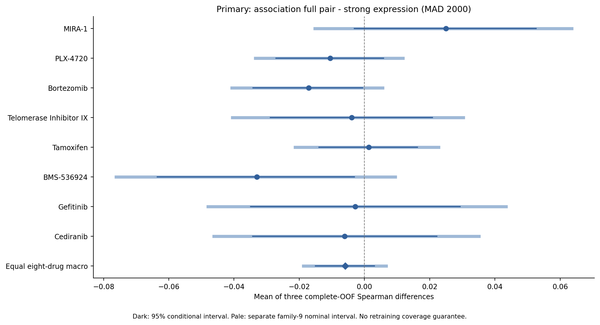
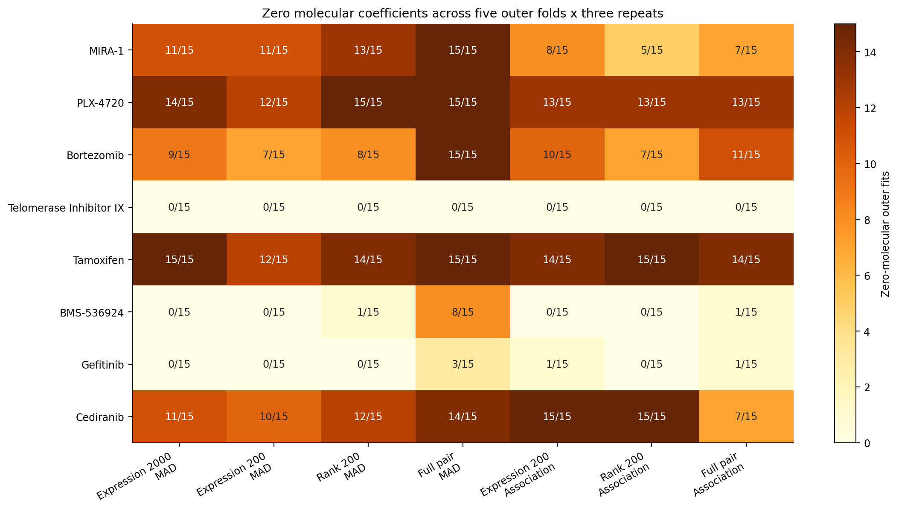

# 阶段6：固定八药候选规则与表示的重复嵌套评价

主宏比较的名义条件区间跨零，现有证据不足以认定REO优于强表达基线；也不能认定非劣或等价。 主宏ΔSpearman及family9区间：-0.00588 [-0.01871, +0.00661]

同一主比较的宏RMSE改善量（强表达RMSE减REO RMSE，正值有利于REO）及未校正95%条件区间：-0.00075 [-0.00124, -0.00028]。排序和误差指标需要同时报告；不能用排序区间跨零来宣称性能相当。REO相对同政策组织参照的宏Δρ及未校正95%条件区间为+0.05654 [+0.04299, +0.07004]；这回答组织均值以外的增量，不能单独建立对表达模型的优势。

固定八药×8臂×5外层×3重复、3内层已完成：960个成功任务、26,160次成功评价拟合、119,208条OOF。独立生物组626个；重复与模型记录不能扩大独立N。既有v1和四案例结果保留，CTRP继续封存，本轮没有新增置换。

## 指标、配对与推断范围

每种药物、每个模型先分别计算三份完整OOF的指标，再平均三个指标；不先平均预测再求相关，不将15个相关外折当独立试验。所有药物、模型和重复共享626组的10,000次bootstrap，Spearman按每次抽样的重复数重新计算精确并列秩。任何组成无定义则保留NA，不能删除药物或重复后重新定义宏平均。

主比较是响应关联候选pair相对MAD2000强表达的Spearman，8药+宏平均构成family9。两种规则各自pair−表达200的Spearman构成单独family18。其它比较及RMSE/MAE/R²为未校正描述；两个家族不提供全研究共同覆盖保证。区间均条件于现有OOF，不包含重新选特征、调参及训练的不确定性；family18双尾每端约14个bootstrap次序量，名义尾部区间不能解读为精确算法覆盖或P值。

新版受历史开发结果启发，不是独立确证。未论证非劣界值、未执行非劣或等效检验；区间跨零不证明信息完全保留。三个候选×表示差分之差在同次抽样和重复内计算、存在代数关联，不是幅度、维数、共线性或惩罚的因果分摊。

图1：主比较的三次完整OOF指标平均差；两种区间均为条件区间。

| 药物 | Δρ及family9区间 | 边际95%区间 | 三个重复Δρ（按顺序） | RMSE改善量及95%CI |
| --- | --- | --- | --- | --- |
| MIRA-1 | +0.02499 [-0.01522, +0.06353] | +0.02499 [-0.00306, +0.05262] | +0.03562 / +0.02889 / +0.01045 | +0.00002 [-0.00057, +0.00057] |
| PLX-4720 | -0.01053 [-0.03341, +0.01177] | -0.01053 [-0.02713, +0.00582] | -0.03277 / +0.00000 / +0.00117 | -0.00047 [-0.00096, -0.00004] |
| Bortezomib | -0.01706 [-0.04072, +0.00553] | -0.01706 [-0.03421, -0.00058] | -0.01079 / -0.02646 / -0.01392 | -0.00070 [-0.00144, +0.00002] |
| Telomerase Inhibitor IX | -0.00389 [-0.04047, +0.03030] | -0.00389 [-0.02881, +0.02082] | -0.00940 / +0.00651 / -0.00877 | -0.00028 [-0.00199, +0.00143] |
| Tamoxifen | +0.00132 [-0.02128, +0.02269] | +0.00132 [-0.01390, +0.01619] | +0.00000 / +0.00000 / +0.00396 | -0.00018 [-0.00036, -4.77e-06] |
| BMS-536924 | -0.03302 [-0.07615, +0.00946] | -0.03302 [-0.06355, -0.00312] | -0.03816 / -0.03603 / -0.02489 | -0.00281 [-0.00459, -0.00104] |
| Gefitinib | -0.00281 [-0.04802, +0.04344] | -0.00281 [-0.03488, +0.02935] | +0.02126 / -0.00912 / -0.02057 | -0.00087 [-0.00273, +0.00099] |
| Cediranib | -0.00605 [-0.04618, +0.03510] | -0.00605 [-0.03426, +0.02220] | +0.00279 / -0.01619 / -0.00475 | -0.00070 [-0.00307, +0.00103] |
| Equal eight-drug macro | -0.00588 [-0.01871, +0.00661] | -0.00588 [-0.01501, +0.00301] | -0.00393 / -0.00655 / -0.00716 | -0.00075 [-0.00124, -0.00028] |

## 匹配200基因的表示比较与候选规则作用

| 药物 | 候选规则 | pair−表达200及family18区间 | 边际95%区间 |
| --- | --- | --- | --- |
| MIRA-1 | mad | +0.02513 [-0.00619, +0.05989] | +0.02513 [+0.00398, +0.04679] |
| MIRA-1 | response_association | +0.02003 [-0.02969, +0.06983] | +0.02003 [-0.01295, +0.05195] |
| PLX-4720 | mad | -0.01765 [-0.05061, +0.01443] | -0.01765 [-0.03890, +0.00340] |
| PLX-4720 | response_association | -0.00693 [-0.03451, +0.02096] | -0.00693 [-0.02487, +0.01088] |
| Bortezomib | mad | -0.01160 [-0.03855, +0.01648] | -0.01160 [-0.03012, +0.00655] |
| Bortezomib | response_association | -0.01200 [-0.03044, +0.00620] | -0.01200 [-0.02454, +0.00023] |
| Telomerase Inhibitor IX | mad | -0.02474 [-0.05887, +0.00580] | -0.02474 [-0.04590, -0.00363] |
| Telomerase Inhibitor IX | response_association | -0.00687 [-0.03298, +0.01848] | -0.00687 [-0.02357, +0.00973] |
| Tamoxifen | mad | -0.01579 [-0.04734, +0.01360] | -0.01579 [-0.03559, +0.00376] |
| Tamoxifen | response_association | +0.00192 [-0.01521, +0.01893] | +0.00192 [-0.00928, +0.01290] |
| BMS-536924 | mad | -0.04448 [-0.09590, +0.00488] | -0.04448 [-0.07734, -0.01253] |
| BMS-536924 | response_association | -0.01715 [-0.04968, +0.01585] | -0.01715 [-0.03787, +0.00346] |
| Gefitinib | mad | -0.04702 [-0.08690, -0.00772] | -0.04702 [-0.07349, -0.02116] |
| Gefitinib | response_association | -0.00557 [-0.05289, +0.04215] | -0.00557 [-0.03654, +0.02487] |
| Cediranib | mad | -0.00503 [-0.03865, +0.02912] | -0.00503 [-0.02678, +0.01640] |
| Cediranib | response_association | +0.00856 [-0.04260, +0.05652] | +0.00856 [-0.02391, +0.04003] |
| Equal eight-drug macro | mad | -0.01765 [-0.03117, -0.00406] | -0.01765 [-0.02660, -0.00891] |
| Equal eight-drug macro | response_association | -0.00225 [-0.01438, +0.00949] | -0.00225 [-0.01038, +0.00582] |

| 宏比较 | Δρ及边际95%CI | 家族 |
| --- | --- | --- |
| primary:association_pair-strong_expression | -0.00588 [-0.01501, +0.00301] | primary_fixed9 |
| mad:pair_full-expression | -0.01765 [-0.02660, -0.00891] | representation_fixed18 |
| mad:rank-expression | -0.01244 [-0.01879, -0.00622] | descriptive |
| mad:pair_full-rank | -0.00521 [-0.01221, +0.00181] | descriptive |
| response_association:pair_full-expression | -0.00225 [-0.01038, +0.00582] | representation_fixed18 |
| response_association:rank-expression | +0.00441 [-0.00150, +0.01030] | descriptive |
| response_association:pair_full-rank | -0.00666 [-0.01456, +0.00103] | descriptive |
| expression:association-MAD | +0.00561 [-0.00472, +0.01573] | descriptive |
| rank:association-MAD | +0.02246 [+0.01305, +0.03194] | descriptive |
| pair_full:association-MAD | +0.02101 [+0.01121, +0.03060] | descriptive |
| mad_expression-tissue_null | +0.05317 [+0.03994, +0.06695] | descriptive |
| mad_rank-tissue_null | +0.04073 [+0.02924, +0.05274] | descriptive |
| mad_pair_full-tissue_null | +0.03553 [+0.02558, +0.04567] | descriptive |
| response_association_expression-tissue_null | +0.05879 [+0.04535, +0.07231] | descriptive |
| response_association_rank-tissue_null | +0.06319 [+0.05038, +0.07646] | descriptive |
| response_association_pair_full-tissue_null | +0.05654 [+0.04299, +0.07004] | descriptive |
| mad_expression-expression_strong | -0.00924 [-0.01816, -0.00016] | descriptive |
| mad_rank-expression_strong | -0.02168 [-0.03046, -0.01308] | descriptive |
| mad_pair_full-expression_strong | -0.02689 [-0.03603, -0.01796] | descriptive |
| response_association_expression-expression_strong | -0.00363 [-0.01198, +0.00462] | descriptive |
| response_association_rank-expression_strong | +0.00078 [-0.00764, +0.00904] | descriptive |
| expression_strong-tissue_null | +0.06242 [+0.04926, +0.07577] | descriptive |
| interaction:rank-expression | +0.01685 [+0.00846, +0.02534] | descriptive |
| interaction:pair_full-rank | -0.00145 [-0.01181, +0.00883] | descriptive |
| interaction:pair_full-expression | +0.01539 [+0.00350, +0.02731] | descriptive |

完整25种比较×9个单位×4指标均保存于paired_effect_intervals.csv。共享候选基因使三种表示输入范围相同；响应关联规则以连续log表达为筛选基础，规则与表示仍可能交互。完整pair与平均秩承载相同序信息，但线性函数范围和EN惩罚不等价。

## 零分子解、重复波动与特征稳定性

图2：每药每臂15次外层拟合中的零分子解，包括强表达基线。零解未剔除。

840个分子外层模型中零分子解430个。各重复预测相对同政策组织均值的RMS偏离单列；非零系数和预测变化不自动等于有效分子增量。恰好相同预测造成的[0,0]区间只是本批记录相同，不是算法等价证据。

repeat_stability.csv给出每个模型/比较的三个完整重复指标、范围及SD，不把三个重复当三项独立研究。feature_stability.csv比较15个外层模型的105组组合，区分同重复不同折与不同重复，记录训练样本Jaccard以显示重叠。双空活跃集合记NA；不同维数空间的活跃Jaccard不能直接当算法优劣排名，预测增量也不能代替稳定机制签名。

## 计算、暂停和失败的实际记录

最终成功任务墙钟和3.98小时，最大任务采样RSS 0.976GiB；外层任务包括初始化/内层调参/重拟合。全成功预算内求解警告0、回退0。资源是本机实际观察，受缓存、任务顺序、系统负载和重启影响，不能声称隔离计算效率优势。

| 操作审计项目 | 实际值 |
| --- | --- |
| successful_pipeline_fits | 26,160 |
| failed_attempt_completed_fit_events | 0 |
| resource_probe_fit_events | 0 |
| completed_fit_events_total | 26,160 |
| failed_incomplete_fit_attempts | 0 |
| attempted_fit_total_lower_bound | 26,160 |
| successful_task_wall_seconds_sum | 14,340.37 |
| failed_attempt_wall_seconds_sum | 0.00 |
| resource_probe_wall_seconds | 0.00 |
| controller_session_wall_seconds_sum | 16,431.15 |
| elapsed_first_start_to_final_finish_seconds | 16,431.15 |
| inter_session_gap_seconds | 0.00 |
| resource_paused_session_count | 0 |
| failed_session_count | 0 |

成功任务、失败尝试、资源probe和未完成调用分别计数。任务wall从execute_task入口计时，包括worker初始化、数据准备及嵌套评价，但不包括此前子进程启动和数值库导入；不能将它称为fresh-child完整端到端耗时。若会话审计另列child_wall_seconds_sum，则包含子进程启动与等待。控制器会话时间包含任务时间，不能重复累加；首末历时还包含会话间隔，间隔可能含资源等待、调查和人工暂停，不等于纯休眠。资源不足的安全暂停不算模型失败，未完成运行不得生成最终成绩报告。

## 下一步边界与可复现材料

是否继续外验应同时考虑逐药与宏效应、误差指标、组织以上增量、重复波动和特征稳定性，不能只挑排序点估计或表现好的药物。当前评价不证明临床转化，也未检验RNA-seq至芯片迁移。最终全开发模型与外验统计方案另行冻结后，才能执行既定CTRP跨药敏筛选评价。

统计来源与代码哈希见results/ordinal_repeated/analysis_provenance.json；候选/活跃特征、参数边界、零解、资源及覆盖有独立聚合表。个体OOF、训练成员和bootstrap组权重仍留在本地runs；本报告只读取完成后的元数据、独立审计和聚合结果。唯一总计划为RESEARCH_PLAN.md。
